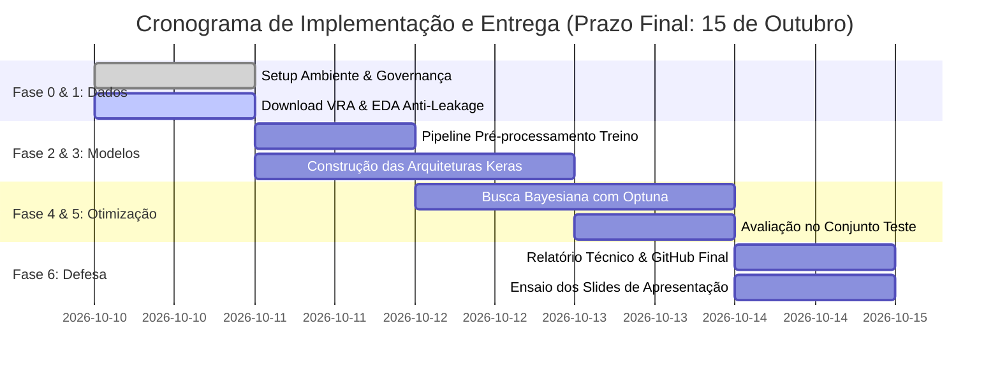

# PLANO DE IMPLEMENTAÇÃO VERSIONADO (v1.1.0)
## Trabalho Prático de Deep Learning — Voo Regular Ativo (VRA / ANAC)

---

### Controle de Versão do Documento
| Versão | Data | Autor(es) | Descrição das Mudanças | Status |
| :--- | :--- | :--- | :--- | :--- |
| **v1.0.0** | 10/10/2026 | Equipe de Pesquisa & Desenvolvimento | Versão inicial consolidada baseada estritamente no edital do trabalho, no Guia Metodológico VRA (`deep_learning_trabalho.html`) e nas 8 aulas expositivas do Prof. Dr. Sérgio Canuto (IFG). | Superada |
| **v1.1.0** | 10/10/2026 | Equipe de Pesquisa & Desenvolvimento | **Definição Metodológica das Frentes:** Fixação formal da **Frente 3.1 (Multilayer Perceptrons - MLP)** como arquitetura principal de desenvolvimento e da **Frente 3.2 (Redes Recorrentes - LSTM/GRU/SimpleRNN)** como frente de estudo comparativo de modelagem temporal vs. tabular. | **Aprovado para Implementação** |

---

## 1. Sumário Executivo & Alinhamento RAG (Base de Conhecimento Estrita)

Este documento estabelece o **Plano de Implementação Científico e Técnico** para o trabalho final da disciplina de **Deep Learning (2026/2)**, ministrada pelo **Prof. Dr. Sérgio Canuto**.

### 1.1 Premissas Rígidas e Rastreabilidade de Conteúdo ("RAG Fechado")
O projeto é blindado contra qualquer metodologia ou jargão externo não ministrado em sala de aula. Todo o pipeline, código, escolhas hiperparamétricas e relatórios derivam estritamente do seguinte acervo documental fornecido:

1. **Diretriz de Avaliação:** `Trabalho - Disciplina Deep Learning (2).pdf` (Prazo: 15 de outubro; Apresentação: 10 min; Repositório GitHub; 4 Critérios de Avaliação pontuados de I a IV totalizando 10 pts).
2. **Base de Dados Governamental:** `base.md` — Microdados abertos de Voos e Operações Aéreas — Voo Regular Ativo (VRA/ANAC) do Portal Brasileiro de Dados Abertos.
3. **Guia Metodológico Técnico:** `deep_learning_trabalho.html` — Pipeline antifalhas de Data Leakage, formulação matemática das variáveis alvo e arquitetura do estudo Optuna.
4. **Acervo Teórico e Prático das Aulas (Prof. Sérgio Canuto):**
   - `Deep Learning - Intro 2026_2 (2).pdf`: Fundamentos, histórico, motivação e conexão cérebro-computador.
   - `Deep Learning - Neurônios Artificiais 2026_2 (2).pdf`: Do Perceptron de Rosenblatt / LTU ao Multilayer Perceptron (MLP) e o problema do XOR.
   - `Deep Learning - Backpropagation 2026_2 (2).pdf`: Teorema da Aproximação Universal (Hornik, Stinchcombe, White, 1989; Kolmogorov), funções de ativação ($\text{Sigmoid}, \tanh, \text{ReLU}$), custo (MSE, Binary Cross-Entropy, Categorical Cross-Entropy) e derivação da Regra da Cadeia no Backpropagation.
   - `Deep Learning - parametrizacao 2026_2 (1).pdf`: Pré-processamento, inicialização de pesos (Glorot/Xavier, He), regularização ($\text{L}_1/\text{L}_2$, Dropout), Batch Normalization, Early Stopping, Otimização Bayesiana com Optuna, 5-Fold Cross-Validation e TensorBoard.
   - `Deep Learning - Redes recorrentes 2026_2.pdf`: Sequências temporais, Backpropagation Through Time (BPTT), desaparecimento do gradiente, SimpleRNN vs. LSTM (portas de esquecimento, entrada, saída, estado de célula $c_t$) vs. GRU (reset e update gates).
   - `Deep Learning - Convolução 2026_2.pdf`: Operações convolucionais, filtros, strides, padding ('valid' vs. 'same'), pooling (Max/Average) e receptive field.
   - `Deep Learning - Arquiteturas CNN - 2026_2.pdf`: Famílias consagradas (VGG16/19, GoogLeNet/Inception com convoluções $1 \times 1$, ResNet com conexões residuais/skip connections), Transfer Learning (Fine-Tuning vs. Feature Extraction/Camadas Congeladas) e Data Augmentation.
   - `Deep Learning - Autoencoders - 2026_2.pdf`: Autoencoders tradicionais/subcompletos (bottleneck dimensional), visualização do espaço latente 2D, Denoising Autoencoders, imputação de dados faltantes e compactação de representação para alimentação de classificadores MLP.

---

## 2. Visão Geral do Problema e Formulação Metodológica no VRA

### 2.1 O Dataset VRA / ANAC
- **Origem:** Portal Brasileiro de Dados Abertos (ANAC).
- **Unidade de Observação:** O registro individual de um voo regular comercial planejado e/ou executado em espaço aéreo nacional.
- **Atributos Nucleares:** `ICAOEmpresaAerea`, `NumeroVoo`, `CodigoDI`, `CodigoTipoLinha`, `ICAOAerodromoOrigem`, `ICAOAerodromoDestino`, `PartidaPrevista`, `PartidaReal`, `ChegadaPrevista`, `ChegadaReal`, `SituacaoVoo`, `CodigoJustificativa`.

### 2.2 Formulação do Problema Preditivo e Seleção das Frentes
O trabalho adota a formulação de **Classificação Binária de Atraso Crítico de Chegada** ($> 15$ minutos), estruturando a investigação em duas camadas:

$$\text{AtrasoChegadaMin} = \frac{\text{DataHoraReal}_{\text{chegada}} - \text{DataHoraPrevista}_{\text{chegada}}}{60 \text{ segundos}}$$

$$y_{\text{bin}} = \begin{cases} 1, & \text{se } \text{AtrasoChegadaMin} > 15 \text{ min} \\ 0, & \text{caso contrário} \end{cases}$$

- **Frente Principal de Desenvolvimento (Foco Central):** **Frente 3.1: Multilayer Perceptrons (MLP)**
  - Atende integralmente a todas as exigências da Seção 3.1 do Edital: exploração profunda de largura, profundidade, regularização (Dropout, $\text{L}_2$, Batch Normalization), parada antecipada e comparação das 3 variações com busca bayesiana pelo Optuna.
- **Frente Comparativa Experimental:** **Frente 3.2: Redes Recorrentes (LSTM / GRU / SimpleRNN)**
  - Modelagem temporal sequencial multivariada para comparação direta com a MLP: investigar se o custo adicional de manter estados recorrentes e processar janelas temporais de voos ($W \in \{5, 10\}$) supera o desempenho da representação tabular densa da MLP.

---

## 3. Matriz de Fases e Marcos do Cronograma de Implementação

O cronograma foi dimensionado de forma estrita para entrega e apresentação até **15 de outubro**.



---

## 4. Detalhamento Técnico por Fase de Execução

### FASE 0: Governança, Repositório e Ambiente Reprodutível
- **Objetivo:** Estabelecer a infraestrutura de código, versionamento e dependências sem conflitos.
- **Entregáveis Técnicos:**
  - Repositório Git local e espelho no GitHub.
  - `requirements.txt` fixando: `tensorflow>=2.14`, `optuna>=3.4`, `scikit-learn`, `pandas`, `numpy`, `matplotlib`, `seaborn`, `tensorboard`.
  - Estrutura física de diretórios:
    ```text
    deep_learning_trabalho_final/
    ├── data/
    │   ├── raw/             # Dados brutos do VRA (ignorado no .gitignore)
    │   └── processed/       # Metadados de encoders e splits
    ├── notebooks/
    │   ├── 01_eda_vra.ipynb
    │   ├── 02_preprocessing_splits.ipynb
    │   ├── 03_optuna_experiments.ipynb
    │   └── 04_final_evaluation.ipynb
    ├── src/
    │   ├── data_pipeline.py # Carregamento e higienização sem leakage
    │   ├── models.py        # Fábrica de modelos (Keras / TF)
    │   ├── tuning.py        # Objetivos Optuna e callbacks
    │   └── evaluation.py    # Curvas de loss, métricas e custo
    ├── reports/
    │   ├── relatorio_tecnico.pdf
    │   └── slides_apresentacao.pdf
    ├── specs/
    │   ├── plano_implementacao_versionado.md
    │   └── specs_detalhadas.md
    ├── documentos/          # PDFs de aula e editais (RAG de referência)
    ├── README.md
    └── requirements.txt
    ```
- **Critério de Aceite da Fase:** Ambiente executando `python -c "import tensorflow as tf; print(tf.__version__)"` e script de validação de GPU/CPU funcional.

---

### FASE 1: Ingestão de Microdados VRA e Análise Exploratória (EDA)
- **Objetivo:** Carregar os microdados oficiais do VRA, diagnosticar a integridade física dos registros e documentar as propriedades estatísticas.
- **Ações Obrigatórias do Edital (Seção 2.1):**
  1. Identificar as colunas de entrada e de saída com tipos e unidades de medida.
  2. Apresentar distribuições de atributos contínuos (horários, tempos programados de rota).
  3. Contabilizar frequência de nulos, duplicados e anomalias de preenchimento.
  4. Analisar criticamente o desbalanceamento da variável alvo ($y_{\text{bin}}$ tem tipicamente ~80-85% pontual e ~15-20% atrasado).
  5. Justificar a **exclusão peremptória de variáveis geradoras de vazamento**:
     - *Exclusão obrigatória de:* `ChegadaReal`, `PartidaReal` (quando o alvo for atraso de partida), `CodigoJustificativa` (preenchido pós-fato).
- **Critério de Aceite da Fase:** Notebook `01_eda_vra.ipynb` gerando gráficos de barras de classes, histogramas de tempos e tabela de diagnóstico nulos/outliers.

---

### FASE 2: Engenharia de Recursos e Particionamento Anti-Vazamento (Anti-Leakage)
- **Objetivo:** Implementar o particionamento científico e o isolamento dos estimadores conforme os slides de Parametrização e o Edital (Seções 2.2 e 2.3).
- **A Regra de Ouro (Slides de Parametrização):**
  - Nenhum parâmetro estatístico ($\mu, \sigma$, valores mínimos e máximos, vocabulário de categorias de `OneHotEncoder`) pode ser calculado no conjunto completo.
  - $\mu_{\text{treino}}$ e $\sigma_{\text{treino}}$ são extraídos unicamente de $D_{\text{treino}}$ e repassados por inferência para $D_{\text{val}}$ e $D_{\text{teste}}$.
- **Estratégia de Particionamento:**
  - **Divisão Cronológica (Séries Temporais):** 70% Treinamento (meses anteriores), 15% Validação (meses intermediários), 15% Teste (meses finais mais recentes).
  - É expressamente vedado o uso de `train_test_split(shuffle=True)` que permitiria prever voos do passado utilizando dados do futuro.
- **Transformações de Features:**
  - Extração cíclica senoidal/cossinoidal da hora prevista de partida:
    $$\text{hora}_{\sin} = \sin\left(\frac{2\pi \cdot \text{hora}}{24}\right), \quad \text{hora}_{\cos} = \cos\left(\frac{2\pi \cdot \text{hora}}{24}\right)$$
    $$\text{dia\_semana}_{\sin} = \sin\left(\frac{2\pi \cdot \text{dia}}{7}\right), \quad \text{dia\_semana}_{\cos} = \cos\left(\frac{2\pi \cdot \text{dia}}{7}\right)$$
  - `StandardScaler` aplicado às variáveis numéricas contínuas.
  - `OneHotEncoder(handle_unknown='ignore')` nas principais empresas (`ICAOEmpresaAerea`) e rotas aeroportuárias.
- **Critério de Aceite da Fase:** Pipeline montado com `sklearn.compose.ColumnTransformer` que ajusta (`fit`) apenas em $D_{\text{treino}}$ e transforma (`transform`) em validação e teste sem vazamento de dados.

---

### FASE 3: Modelagem e Arquiteturas Conforme as Frentes de Aula
- **Objetivo:** Projetar as arquiteturas neurais utilizando Keras/TensorFlow com rigor teórico alinhado aos slides do Prof. Sérgio Canuto, adotando a MLP como modelo nuclear e a rede recorrente como comparativo temporal.

#### Estruturação das Frentes no Projeto:
1. **Frente 3.1: Multilayer Perceptrons (MLP) — ARQUITETURA PRINCIPAL**
   - **Fundamentação:** Teorema de Aproximação Universal (Hornik, 1989; Kolmogorov) como base de capacidade representacional sobre os atributos tabulares e cíclicos do VRA.
   - **Espaço Arquitetural:** Variação sistemática de profundidade ($L \in [1, 4]$ camadas ocultas) e largura ($N \in [32, 512]$ neurônios).
   - **Estratégias de Regularização de Aula:** Dropout ($\text{taxa} \in [0.1, 0.5]$), Penalização $\text{L}_2$ (`kernel_regularizer=l2(lambda)`), Batch Normalization entre densas e ativações, Inicialização He Normal para $\text{ReLU}$ e Glorot Uniform para $\text{Sigmoid}$.
   - **As 3 Variações Comparadas:** (1) MLP Rasa Baseline; (2) MLP Profunda Regularizada; (3) MLP Otimizada via Optuna.
2. **Frente 3.2: Redes Recorrentes (RNN / LSTM / GRU) — ESTUDO COMPARATIVO**
   - **Modelagem Temporal:** Agrupamento dos voos ordenados por aeródromo de origem ou rota em tensores 3D com janelas temporais de $W \in \{5, 10\}$ voos anteriores.
   - **Comparação Tripla Experimental:** Avaliação de `SimpleRNN` vs. `GRU` vs. `LSTM` sob condições de treino equivalentes.
   - **Questão Científica Central do Comparativo:** Analisar se a preservação explícita de dependências temporais nas células recorrentes justifica o custo computacional adicional e a latência de inferência quando comparada à MLP densa otimizada.
- **Critério de Aceite da Fase:** Módulo `src/models.py` contendo classes/funções construtoras modularizadas para as redes, com parâmetros de compilação coerentes (loss `binary_crossentropy`, otimizador `Adam`, métricas `accuracy`, `AUC`, `Precision`, `Recall`).

---

### FASE 4: Hiperparametrização Bayesiana com Optuna
- **Objetivo:** Conduzir busca inteligente do espaço de parâmetros conforme exigido na Seção 2.4 do Edital e nos slides de Parametrização.
- **Diretrizes Rígidas do Edital:**
  - Proibido relatar apenas o resultado final: é obrigatório registrar o espaço de busca, o número de tentativas (*trials*), o método de amostragem (TPE - Tree-structured Parzen Estimator) e o algoritmo de poda (*pruner*).
  - A métrica objetiva deve ser calculada **exclusivamente na partição de Validação**.
- **Espaço de Busca Justificado:**
  | Hiperparâmetro | Tipo de Amostragem | Intervalo / Opções | Justificativa Teórica (Slides Prof. Canuto) |
  | :--- | :--- | :--- | :--- |
  | `learning_rate` | Logarítmico (`log=True`) | $[10^{-4}, 10^{-1}]$ | Evita convergência lenta (subajuste) ou oscilações caóticas/explosão de gradiente. |
  | `batch_size` | Categórico | $\{32, 64, 128, 256\}$ | Trade-off entre ruído estocástico de gradiente (regularização implícita) e paralelismo de hardware. |
  | `n_layers` | Inteiro linear | $[1, 4]$ | Explora o Teorema de Kolmogorov vs. overfitting de profundidade. |
  | `units` | Categórico / Inteiro | $\{32, 64, 128, 256, 512\}$ | Controla a capacidade expressiva da hipótese da rede. |
  | `dropout_rate` | Flutuante linear | $[0.0, 0.5]$ | Previne coadaptação de neurônios sem degradar a capacidade mínima de aprendizado. |
  | `l2_reg` | Logarítmico (`log=True`) | $[10^{-6}, 10^{-2}]$ | Penaliza pesos de alta magnitude (Weight Decay). |
  | `activation` | Categórico | `['relu', 'elu', 'leaky_relu']` | Mitiga o problema dos neurônios mortos (Dying ReLU). |
- **Poda Antecipada (*Pruning*):**
  - Implementar `optuna.pruners.MedianPruner(n_startup_trials=5, n_warmup_steps=10)` acoplado ao callback de treino Keras.
- **Critério de Aceite da Fase:** Script/Notebook `03_optuna_experiments.ipynb` gerando arquivo SQLite/RDB do estudo Optuna, visualização de importância dos hiperparâmetros (`plot_param_importances`) e histórico de otimização (`plot_optimization_history`).

---

### FASE 5: Avaliação Experimental e Análise Custo-Efetividade
- **Objetivo:** Medir o desempenho científico final e avaliar o trade-off computacional exigido nas Seções 2.5 e 6 do Edital.
- **Protocolo de Avaliação no Conjunto Teste:**
  1. O conjunto de teste é acessado **uma única vez** pelo modelo vencedor de cada variação.
  2. Métricas de Classificação (Desbalanceamento):
     - **Métrica Principal:** Macro F1-Score (média harmônica balanceada das classes).
     - **Métricas Complementares:** Precision, Recall, Matriz de Confusão Normalizada, AUC-ROC e Curva Precision-Recall (PR-AUC).
  3. Diagnóstico de Convergência:
     - Gráficos comparativos de curvas de aprendizado: Loss no Treino vs. Loss na Validação por época.
     - Discussão formal de pontos de subajuste (ambas perdas elevadas) e sobreajuste (perda de treino em queda com validação divergindo).
  4. Análise de Custo-Efetividade Computacional:
     - Tabela comparativa medindo:
       * Número de Parâmetros Totais e Treináveis.
       * Tempo Médio de Treinamento por Época (segundos).
       * Tempo de Inferência para 1.000 amostras (milissegundos).
       * Memória alocada em disco/GPU.
- **Critério de Aceite da Fase:** Notebook `04_final_evaluation.ipynb` consolidando tabelas e figuras em alta resolução salvas no diretório `results/`.

---

### FASE 6: Elaboração dos Entregáveis Acadêmicos e Roteiro de Defesa
- **Objetivo:** Redigir o Relatório Técnico final no formato acadêmico exigido e montar os slides para apresentação cronometrada de 10 minutos.
- **Estrutura do Relatório Técnico (Conforme Seção 5 do Edital):**
  1. *Introdução e objetivo do problema:* Contextualização do setor aéreo e pertinência da previsão de atrasos.
  2. *Descrição da fonte e caracterização do conjunto de dados:* Metadados VRA, EDA, gráficos de distribuição e justificativa anti-leakage.
  3. *Arquiteturas, espaço de busca e protocolo de hiperparametrização:* Detalhamento das camadas, ativações, funções de perda e estudo Optuna.
  4. *Resultados de validação e seleção dos modelos promissores:* Comparação das variações arquiteturais, importância de parâmetros e curvas de convergência.
  5. *Avaliação final no conjunto de teste e análise de custo vs efetividade:* Tabela consolidada de métricas de generalização, matrizes de confusão e trade-off de recursos.
  6. *Limitações e conclusões:* Discussão de fatores não observados (clima, manutenção não prevista) e sugestões de trabalhos futuros.
- **Roteiro Estruturado de Apresentação (Slides de 10 Minutos):**
  - **Slide 1-2 (0:00 - 2:00):** Contextualização do VRA, formulação da variável alvo e impacto operacional.
  - **Slide 3-4 (2:00 - 4:00):** Engenharia de features, blindagem de data leakage e divisão temporal.
  - **Slide 5-6 (4:00 - 7:00):** Modelagem neural, espaço de busca bayesiano com Optuna e curvas de perda treino vs. validação.
  - **Slide 7-8 (7:00 - 10:00):** Desempenho no teste cego, matrizes de confusão, custo computacional (tempo/parâmetros) e conclusão.
- **Critério de Aceite da Fase:** Repositório no GitHub contendo README elucidativo, código comentado e apresentação em PDF/PPTX finalizada.

---

## 5. Matriz de Rastreabilidade com os Critérios de Avaliação (10 Pontos)

| Critério Oficial do Edital | Peso | Como este Plano de Implementação Garante a Nota Máxima |
| :--- | :---: | :--- |
| **I) Justificativas das escolhas necessárias para construção e avaliação do método desenvolvido** | **3.0 pts** | Justificação pormenorizada da variável alvo no VRA (>15 min), do pré-processamento anti-vazamento (fit só no treino), da divisão cronológica estrita e da adoção do Macro-F1 para contornar o desbalanceamento das classes aéreas. |
| **II) Corretude da modelagem das arquiteturas na aplicação** | **2.0 pts** | Modelagem rigorosamente alinhada aos slides de aula (funções de ativação ReLU/Sigmoid, regularizadores Dropout/L2/Batch Normalization, otimizador Adam, BPTT em recorrentes ou bottleneck em autoencoders). |
| **III) Domínio de estratégias de hiperparametrização** | **2.0 pts** | Aplicação completa do framework Optuna com amostragem bayesiana (TPE), intervalos justificados teoricamente (LR log-scale, Dropout, batch size), poda inteligente (MedianPruner) e otimização restrita à validação. |
| **IV) Domínio na interpretação dos resultados** | **2.0 pts** | Discussão fundamentada das curvas de convergência (identificação explícita de overfitting e subajuste), matrizes de confusão detalhadas e tabela explícita de trade-off entre acurácia, latência de inferência e número de parâmetros. |
| **Total** | **10.0 pts** | **Alinhamento Integral ao Edital da Disciplina de Deep Learning** |

---

## 6. Próximos Passos Imediatos para a Fase de Especificação Técnica (`specs_detalhadas.md`)

Com a validação deste plano versionado, as especificações técnicas a serem detalhadas a seguir no plano de trabalho compreenderão:
1. **Especificação dos Contratos de Dados (`data_contract.md`):** Dicionário exato de colunas do VRA, regras de tipagem e filtros aplicados.
2. **Especificação de Arquitetura de Software:** Declaração das assinaturas de funções e classes do módulo `src/`.
3. **Especificação Experimental de Execução:** Protocolo de seeds aleatórias (`tf.random.set_seed`, `np.random.seed`), número exato de trials do Optuna e critérios de persistência dos modelos vencedores (`.keras`).
